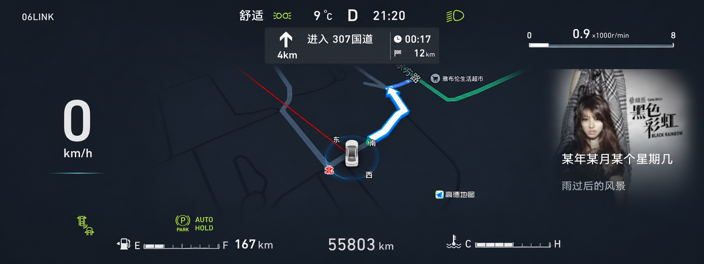
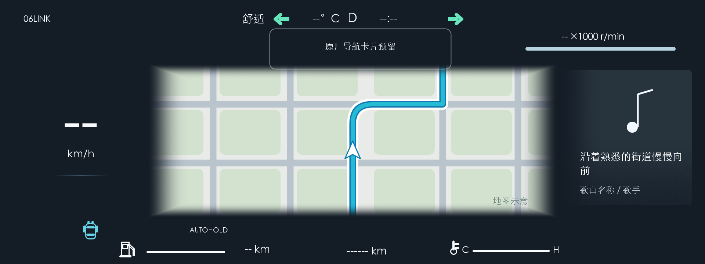
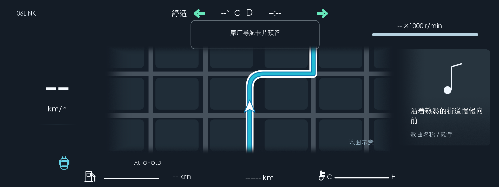
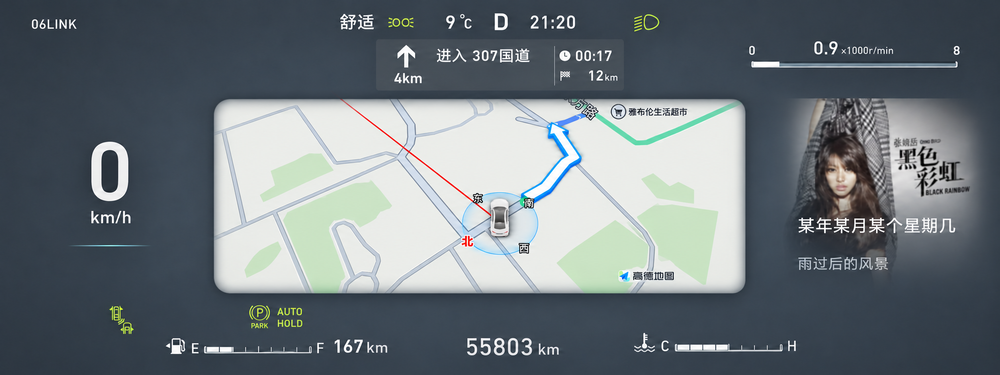
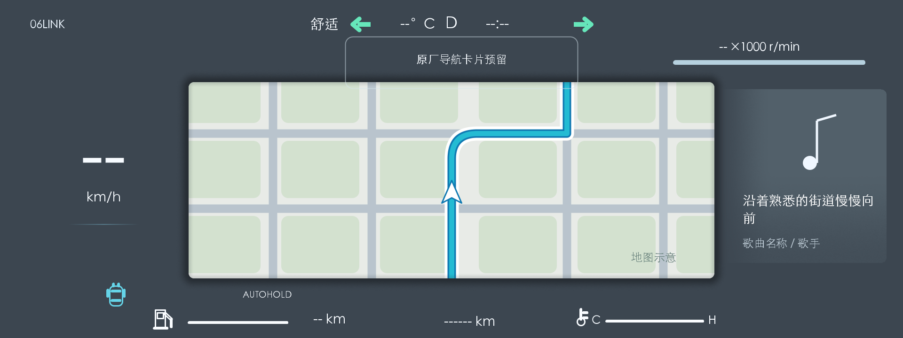
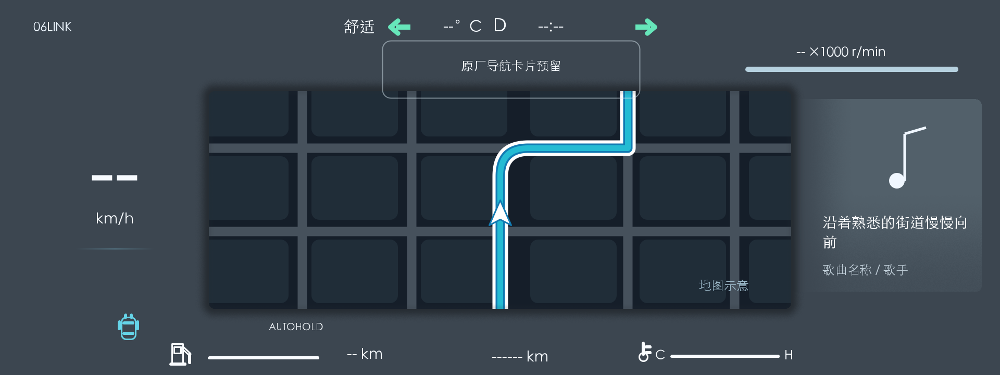
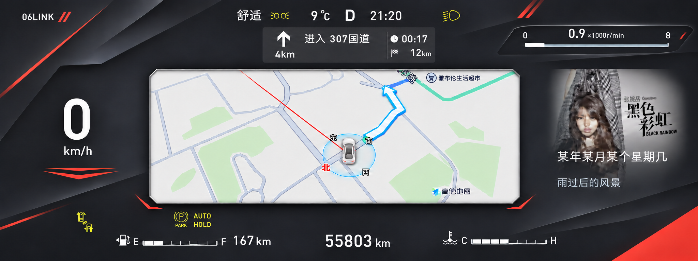
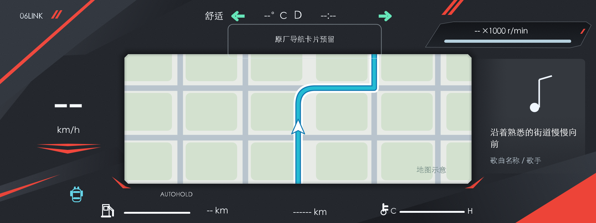
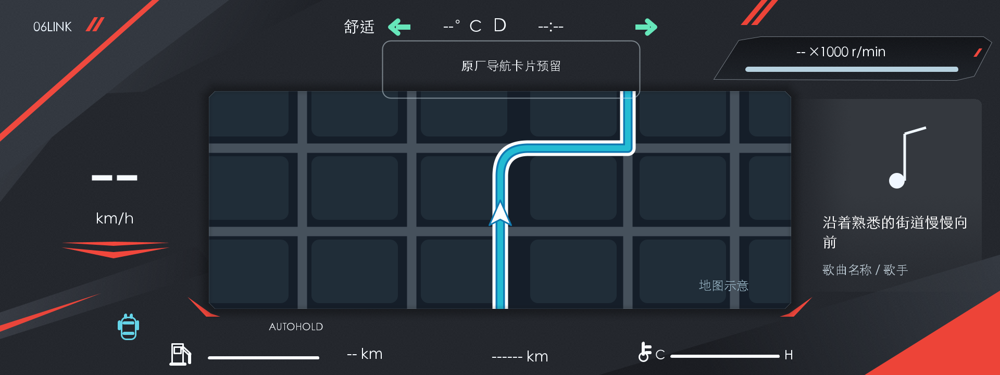

# 仪表样式

06Link 为领克 06 E01 提供五种仪表投屏样式，让地图、音乐与原厂仪表信息共用一块屏幕。本页展示石墨、浮影、竞速三套设计及日夜预览。

| 样式 | 显示特点 |
| --- | --- |
| 信息卡片 | 用卡片边框组织地图与音乐信息。 |
| 全屏地图 | 扩大地图显示区域，音乐卡片可单独开启或关闭。 |
| 石墨仪表 | 深蓝灰底色，地图边缘柔和渐隐，整体简洁连贯。 |
| 浮影仪表 | 中深灰底色，圆角地图窗口搭配外扩软阴影，突出地图层次。 |
| 竞速仪表 | 炭灰底色、红色斜线与切角地图窗口，配合右上方转速区域的斜切底板。 |

设计稿展示视觉效果；日夜预览由对应源码绘制，地图、读数与音乐内容均为示意，并非实车截图。预览中的原厂路口卡片只标出预留位置。

## 石墨仪表

地图通过柔和渐隐融入深蓝灰背景，左侧保留车速区域，右侧显示音乐封面与歌词。适合偏好简洁布局的使用者。

### 设计稿

### 日夜预览

| 白天预览 | 夜间预览 |
| --- | --- |
|  |  |

## 浮影仪表

圆角地图窗口采用窄内沿和外扩软阴影，与背景形成层次。地图、音乐及原厂信息沿用统一的位置安排。

### 设计稿

### 日夜预览

| 白天预览 | 夜间预览 |
| --- | --- |
|  |  |

## 竞速仪表

炭灰背景配合红色斜向装饰，地图使用切角边框。右上方底板围绕原厂转速区域绘制，保持原厂读数的位置。

### 设计稿

### 日夜预览

| 白天预览 | 夜间预览 |
| --- | --- |
|  |  |

## 如何切换

1. 打开 **设置 → 仪表盘 → 投屏样式**。
2. 选择样式，可切换白天／夜间预览查看文字与布局。
3. 点击 **应用样式**，重新连接 CarPlay 后生效。

同一页面还可以调整：

- **内容大小**：标准、较大、最大，调整地图中文字和道路的显示大小。
- **原厂文字颜色**：跟随原车、强制浅色或强制深色；投屏结束后恢复原车模式。
- **音乐卡片**：控制音乐区域显隐；封面、歌手和歌词取决于手机音乐应用提供的信息。
- **仪表过场动画**：单独开启或关闭，关闭立即生效，下次连接按保存的选项播放。

## 原厂信息与地图

车速、转速、挡位、指示灯及底部车辆信息继续由原车仪表显示。06Link 为这些区域预留位置，绘制地图窗口、装饰背景和音乐内容。

原厂路口卡片使用车机自带样式，06Link 接入导航信息，不自定义卡片外观。三套新样式共用地图窗口和安全区域，围绕导航居中进行布局；手机导航决定地图内容及日夜配色，仪表底色保持各自的设计。

[返回项目首页](../../README.md)
